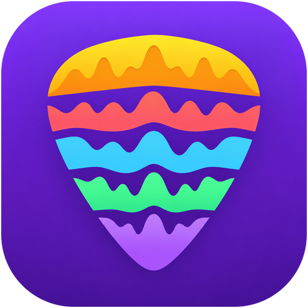
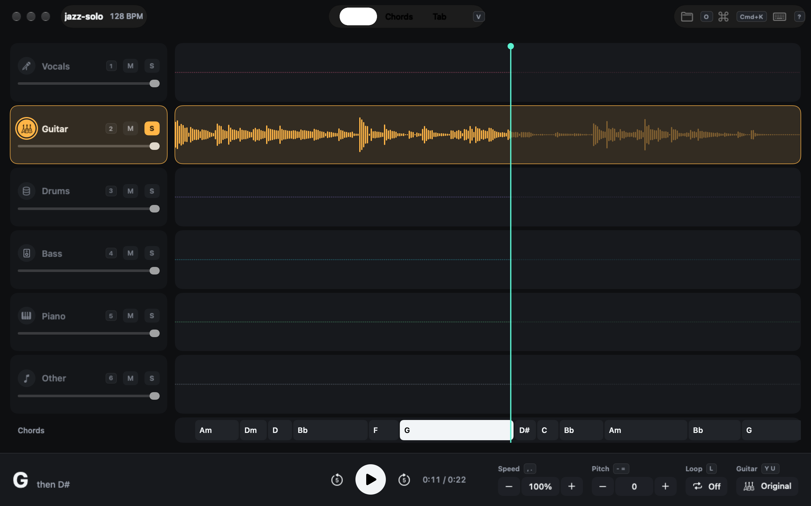
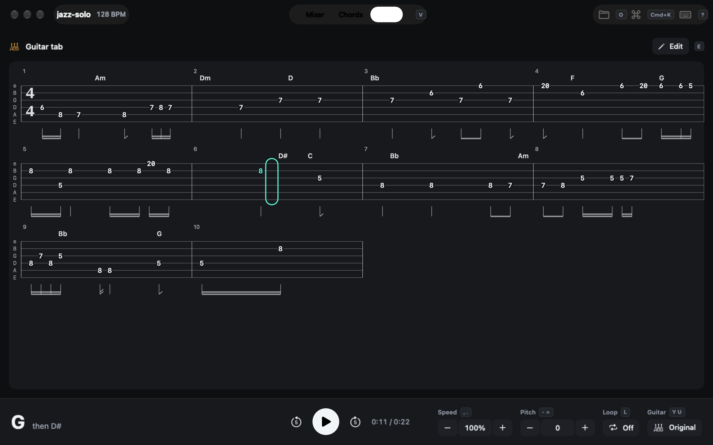
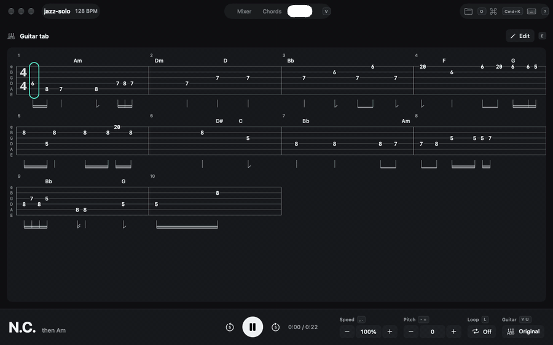
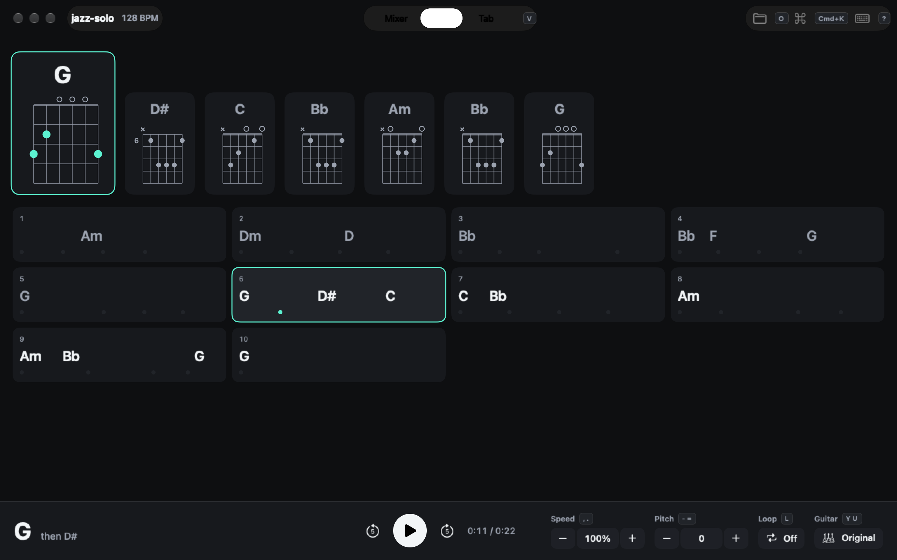
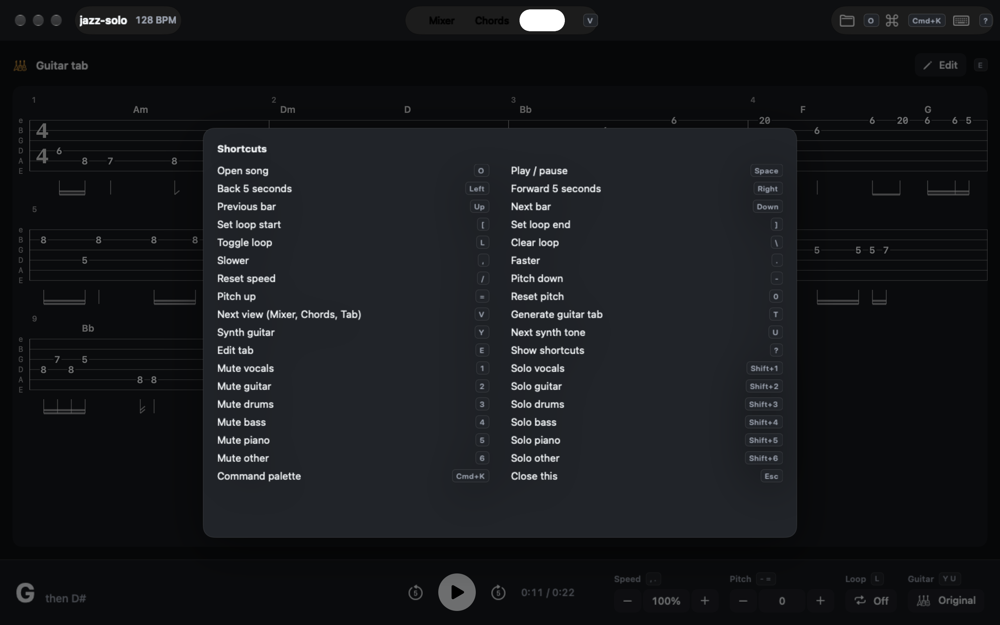

# urdr

A local take on Moises for practising guitar at the desk. Open a song and Urdr splits it into six stems, finds the beats and chords, and transcribes the guitar stem into a Songsterr-style tab you can play along with, loop, slow down and correct by hand. Everything runs on the Mac: a native SwiftUI app in front, a Python engine (Demucs, Beat This!, madmom, Basic Pitch) behind it.

## Screenshots







| Chords | Shortcuts (`?`) |
|---|---|
|  |  |

The song in the screenshots is a jazz solo clip from [GuitarSet](https://zenodo.org/records/3371780) (CC BY 4.0). It is a solo guitar recording, so only the guitar stem carries sound.

## What it does

- **Six stems.** Vocals, guitar, drums, bass, piano and other, separated with Demucs `htdemucs_6s`. Each lane has a waveform, volume, mute and solo. Click a lane to seek, drag to mark a loop.
- **Practice controls.** Play, skip 5 s, jump a bar, speed 50 to 200 %, pitch -12 to +12 semitones and an A-B loop.
- **Beats and chords.** BPM, downbeats and major/minor chords from the full mix, spelled in the song's key. The transport shows the chord now and the next one.
- **Chords view.** What to play now and next as chord diagrams, over a bar grid that follows the song. Click a bar to jump there.
- **Guitar tab.** Generated from the guitar stem (Basic Pitch notes, the top melodic line, then a fingering search across hand positions), laid out in measures with chords above and rhythm below. A cursor follows playback.
- **Tab editing.** The generated tab is a draft: type frets on a grid cursor, move notes between strings, delete and undo. Regenerating keeps the edited version as `tab.edited.json`.
- **Synth guitar.** Plays the tab through a GM guitar (overdriven, clean or acoustic) in place of the original guitar stem.
- **Library.** Each song's stems, analysis and tab are cached under `~/Library/Application Support/Urdr/Songs/`, so a song opens instantly the second time.

## Keyboard shortcuts

| Keys | Action |
|---|---|
| Space | Play / pause |
| Left / Right | Back / forward 5 seconds |
| Up / Down | Previous / next bar |
| `[` / `]` | Set loop start / end |
| `L` / `\` | Toggle / clear loop |
| `,` / `.` / `/` | Slower / faster / reset speed |
| `-` / `=` / `0` | Pitch down / up / reset |
| `1` to `6` | Mute a stem |
| Shift+`1` to Shift+`6` | Solo a stem |
| `V` | Next view (Mixer, Chords, Tab) |
| `T` | Generate the guitar tab |
| `E` | Edit the tab |
| `Y` / `U` | Synth or original guitar / next synth tone |
| `O` | Open a song |
| Cmd+K | Command palette |
| `?` | Shortcut overlay |

While editing the tab: digits type a fret, arrows move the cursor (Shift+Left/Right moves a beat), Shift+Up/Down moves the note to another string, Delete removes it, Cmd+Z undoes, Esc or `E` stops editing.

## Requirements

- macOS 14+ on Apple Silicon (the engine's lockfile only targets arm64 macOS)
- Swift 6 toolchain (Xcode or the command line tools)
- [uv](https://docs.astral.sh/uv/); it installs the engine's Python 3.12 and its dependencies

The first separation and analysis download the Demucs and Beat This! model weights.

## Run it

```sh
cd engine && uv sync
cd ../app && URDR_ENGINE_DIR="$PWD/../engine" swift run -c release Urdr path/to/song.wav
```

The song argument is optional; `O` opens one too, or drop an audio file on the empty window. Without `URDR_ENGINE_DIR` the app looks for the engine in `~/.t3/projects/urdr/engine`.

Tests:

```sh
cd app && swift test
cd engine && uv run python tab.py && uv run python analysis.py   # self-checks
```

## Layout

| Path | What |
|---|---|
| `app/` | The Mac app (SwiftUI, AVAudioEngine): mixer, transport, chords view, tab score and editor |
| `engine/` | Python engine, one subcommand per job (`separate`, `analyze`, `tab`), progress as JSON lines on stdout |
| `engine/eval_guitarset.py` | Scores the tab transcription against GuitarSet annotations |
| `windows/` | Rust port for Windows that opens the same song folders, see [`windows/README.md`](windows/README.md) |
| `PRODUCT.md`, `DESIGN.md` | Product notes and the design system |
